# Birth Face

**A face drawn from the sky at the minute you were born.**

Birth Face is a Windows desktop app. Enter a birth date, an exact time and a place, and it draws a face from the birth chart alone. No photograph is ever used, and nothing about the face is tuned to anyone's real looks. The face is a blend of 408 angel portraits (204 angels, each drawn as a man and as a woman), weighed by the oldest ways the tradition reads appearance from the heavens: the rising sign and its lord, the temperament, the planets, the Moon, the angels of the Name and the angels of the Moon's mansions.


*Three made-up birth moments, three faces. Each is drawn only from its chart.*

---

## Contents

1. [The idea in one paragraph](#the-idea-in-one-paragraph)
2. [The portraits](#the-portraits)
3. [Reading the chart](#reading-the-chart): which places in the chart shape which part of the face, and by how much
4. [Drawing the face](#drawing-the-face): how 408 portraits become one face with single, clean lines
5. [Your choices](#your-choices): hair, skin tone, hair colour and eye colour
6. [In depth: one face, taken completely apart](#in-depth-one-face-taken-completely-apart)
7. [The app](#the-app)
8. [Will it look like you?](#will-it-look-like-you)
9. [Running and building it](#running-and-building-it)

---

## The idea in one paragraph

The astrologers of antiquity and the Renaissance (Ptolemy in the 2nd century, Varahamihira in the 6th, Agrippa in the 16th, William Lilly in the 17th) described the body and face a person would have from the sky at birth: the sign rising on the eastern horizon and its ruling planet give the frame of the face, the Moon gives the eyes and the expression, the balance of hot, cold, moist and dry (the temperament) gives the build and the hair, and each planet adds its own marks. Birth Face takes those rules literally. It works out, for every part of the face, which places in the chart the tradition reads it from, turns those places into shares of angel portraits that stand for them, and blends the portraits the way composite-face research blends photographs: shape and drawing separately, so the result has one averaged shape and one clean set of lines.

---

## The portraits

### Four families of angels

| Family | How many | What each stands for | Source |
|---|---|---|---|
| **Archangels** | 8 | The four elements (Michael fire, Raphael air, Gabriel water, Uriel earth) and the seven planets (Michael the Sun, Gabriel the Moon, Raphael Mercury, Anael Venus, Khamael Mars, Sachiel Jupiter, Cassiel Saturn) | The Golden Dawn quarters; Agrippa, *Three Books*, II |
| **Zodiac angels** | 12 | One for each sign: Malchidiel (Aries), Asmodel, Ambriel, Muriel, Verchiel, Hamaliel, Zuriel, Barbiel, Adnachiel, Hanael, Cambiel, Barchiel (Pisces) | Agrippa; the Golden Dawn |
| **Angels of the Name** | 72 | The Shem ha-Mephorash: each holds five degrees of the zodiac, counted from 0° Aries | Exodus 14:19–21, read as 72 names of three letters |
| **Lunar angels** | 28 | The angels of the 28 mansions of the Moon, each 12°51′ wide | Barrett, *The Magus* (1801), after Agrippa |
| **Lilly's faces** | 84 | The person each of the seven planets describes in each of the twelve signs | Lilly, *An Introduction to Astrology* (ed. Zadkiel, 1852), pp. 180–190 |

Every angel is drawn twice, as a man and as a woman: 408 portraits in all.

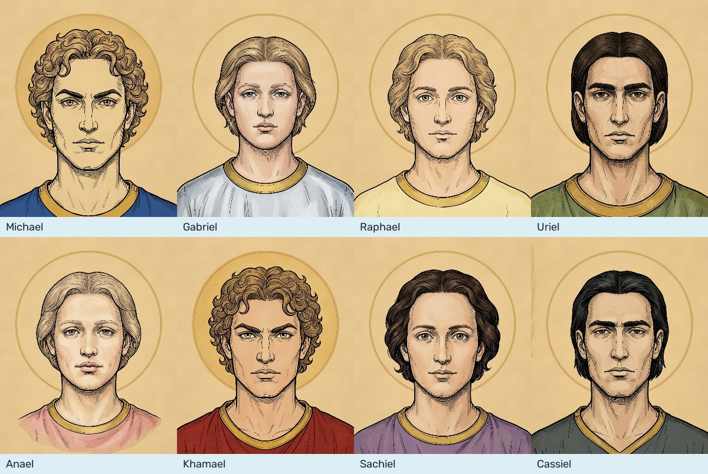

### How the portraits were made

The portraits are original illustrations made for the app with Google's Nano Banana image models, each from a written description of its angel in the tradition's own words. For the archangels and zodiac angels, every feature carries its element's mark, drawn strongly:

| | Water | Earth | Fire | Air |
|---|---|---|---|---|
| Face | rounded, soft, full cheeks | long, lean, narrow, square jaw | angular, high sharp cheekbones, strong chin | balanced oval, open forehead |
| Eyes | large, under heavy, sleepy lids | deep-set under the brow | bright, almond, wide open | open, wide-set, lively |
| Brows | soft, set high | heavy, straight, low | strongly arched, close | fine, even, high |
| Nose | short, rounded tip | long, straight, narrow | prominent, high-bridged | fine, straight |
| Mouth | very full, deep bow | firm, fuller lower lip | wide, thin, crisp | medium, soft bow |

Three rules kept the set honest:

- **No face to copy.** Each man was drawn into an empty layout guide (only the background and the halo) with a separate style sample cut from other drawings that holds no eyes, nose or mouth. A generator shown a face copies it into every portrait; shown none, it draws each angel as its own person. Each woman was then drawn from her man, so the pair is one angel.
- **The marks, not the weight.** Every angel is a healthy, slim adult; heaviness or leanness shows in the bones and features, never as a double chin or hollow cheeks.
- **Colouring left out.** No prompt names a skin, hair or eye colour.

The 20 archangels and zodiac angels and the 28 lunar angels are drawn as gold engravings: sepia pen and ink, cream skin shaded only with hatching and stippling, a gold ground. The angels of the Name and Lilly's faces keep an earlier inked style; in a blend they mostly give shape (see [Drawing the face](#drawing-the-face)), so every finished face keeps the gold style.

### How a new portrait is prepared

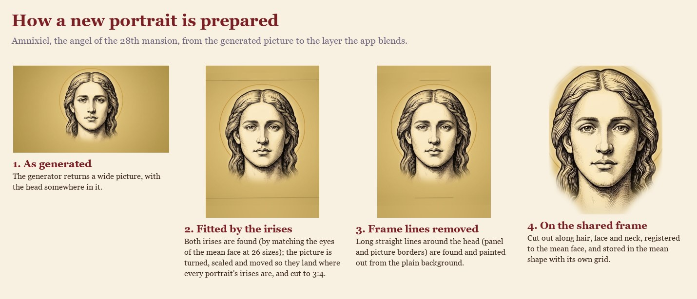

1. **Fitted by its irises.** The generator often returns a wide picture. Both irises are found by matching the eyes of the mean face of the whole set at 26 sizes, and the picture is turned, scaled and moved so the irises land exactly where every other portrait's irises are, then cut to 3:4 (896 × 1200). Where the picture runs out, its own background is carried on smoothly.
2. **Frame lines removed.** Generated pictures sometimes carry a drawn panel or picture border. Long straight lines around (never inside) the head are found and painted out from the plain background, so they cannot show as stray lines beside a blended neck.
3. **Set on the shared frame.** The portrait is cut out along its hair, face and neck, registered to the mean face, and stored in the mean shape together with a grid of its own shape (next section).

---

## Reading the chart

Everything in this section is arithmetic on the chart; the next section turns the numbers into a drawing.

### The chart

The app casts a tropical chart for the exact minute and place (Placidus houses, the Moon corrected for light-time, the angles to under a second of arc). It needs the exact birth time: the rising degree moves about one degree every four minutes, and the Moon about half a degree an hour.

### The temperament

The temperament is worked out by the tally Lilly and his successors used, and gives the face its overall leaning to fire, air, water and earth:

| Testimony | Points |
|---|---|
| The rising sign's element | 2 |
| The ruler of the Ascendant (its own nature, oriental or occidental) | 1 |
| The almuten of the Ascendant (the planet with most dignity at the rising degree) | 1 |
| The Moon's sign | 2 |
| The ruler of the Moon (by the element of its sign) | 1 |
| The Moon's quarter (new to first quarter hot and moist, and so on) | 1 |
| The season of the Sun (spring air, summer fire, autumn earth, winter water) | 2 |

The points become shares: a chart might come out water 50%, air 30%, earth 20%, fire 0%.

### Each part of the face has its own places

The tradition does not read the whole face from one place. Ptolemy (*Tetrabiblos* III.11) and Lilly judge the body from the rising sign, the lord of the Ascendant and the Moon; Ptolemy (III.12) gives the senses to the planets (the Sun sight, the Moon the eyes' look and taste, Venus smell); Mars rules Aries, the sign of the head. So each of the six parts takes its own mix:

| Part | Read from (share) |
|---|---|
| **Hair and outline** | the temperament as a whole |
| **Face shape and jaw** | rising sign 24%, its ruler 20%, Moon 12%, the rising navamsa 8%, the lords of the rising degree's bound, decan and triplicity 14%, planets aspecting the Ascendant 5%, fixed stars on the Ascendant 5%, the Sun 10%; the temperament 25% |
| **Brow and forehead** | Mars 30%, the Sun 20%, the rising sign 15%, stars on the Ascendant 10%; the temperament 25% |
| **Eyes** | the Moon 35%, the Sun 20%, stars with the Moon 10%, the rising sign 10%; the temperament 25% |
| **Nose** | Venus 35%, the Sun 20%, the rising sign 20%; the temperament 25% |
| **Mouth and lips** | the Moon 30%, Venus 25%, stars with the Moon 10%, the Sun 10%; the temperament 25% |

Each place gives the element of the sign it stands in. The temperament anchors every part at 55% and the part's own places give the other 45%, so each part ends up with its own element mix: the eyes of a chart can lean to water while its jaw leans to earth.

### The elemental face

Each part's element mix is turned into portraits:

1. **The archangels of the elements.** Each element is a pair of archangels (fire Michael and Khamael, air Raphael and Sachiel, water Gabriel and Anael, earth Uriel and Cassiel). The element's own archangel leads with 60%, moved up to 15 points either way by the strength of the pair's planets in the chart.
2. **The zodiac angels** of the signs each part is read from take 40% (the rising sign's angel for the frame, the Moon's for the eyes and mouth, Venus's for the nose, Mars's and the Sun's for the brow).
3. **The angels of the Name** take about 30% of the face shape. All 72 are weighed: by where the planets and angles stand among their five-degree spans, by the letters of their names, by their choir's planet and their decan's ruler, with a small equal share for every angel.
4. **The element portraits.** The archangels' eyes and mouths are fewer and less varied than the lunar angels', who were each drawn with their element's eyes and mouth. So part of each element's share in the eyes and mouth (45%), face and brow (35%) and nose (30%) goes to every portrait of that element, the lunar angels leading in the eyes and mouth. Each element's part is its share squared (the tradition names a temperament by its predominant quality).
5. **Lilly's faces** take 30% of the face shape and 25% of each feature: the face Lilly gives the lord of the Ascendant in its sign (half), any planet within 8° of the Ascendant, and the Moon in its sign.
6. **The angel of the Moon's mansion** takes the Moon's own part of the eyes (35%) and the mouth (30%), applied last so nothing dilutes it.

### The planetary face

The seven planetary archangels, each weighed by how strongly its planet shapes the body:

| Testimony | Weight |
|---|---|
| Every planet | 1, plus its essential and accidental dignity (Lilly's points ÷ 10) |
| The Moon | +1 (the Moon shapes the body) |
| The Sun | +0.5 |
| Ruler of the Ascendant | +2 |
| Almuten of the Ascendant | +1 |
| Rising with the Ascendant (within 8°) | up to +3 |
| In the 1st house | +1.5 |
| Lord of the rising degree's bound | +0.75 |
| Lord of its decan, its triplicity, the sect light, aspects to it, fixed stars on it | +0.5 each (scaled by orb) |

Each part then leans to the planets the tradition gives it: the face to Saturn, Jupiter and the Moon; the brow to Mars; the eyes to the Sun and Moon; the nose to Venus; the mouth to the Moon and Venus.

### The finished face's mix

Part by part, the finished face is:

1. **60% the elemental face and 40% the planetary face.**
2. **The rising degree's own layer:** a third of the face shape, brow and nose and a fifth of the mouth. The exact rising degree is read four ways: the **Egyptian decan** and its planet (35% of the layer), **Varahamihira's drekkana** (*Brihat Jataka* 27), the figure rising and its lord (30%), the **two angels of the Name** holding the rising decan's halves (20%), and the **rising navamsa**, the ninth of the sign read for the body (15%). **Lilly's degrees** (*Christian Astrology*, p. 116) add whether the degree is masculine or feminine.
3. **The Moon's angel draws the eyes.** The Moon rules the eyes and their look, and the angel of the mansion the Moon stood in at birth is the one portrait of the Moon's exact place, so it draws 70% of the eyes. The rest of the chart shapes the other 30%. The Moon changes mansion about once a day, so people born a day apart can have quite different eyes.

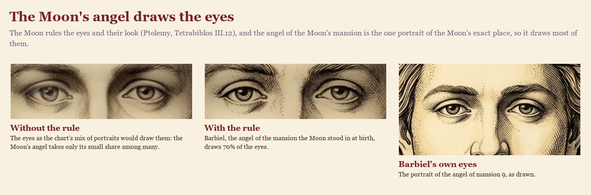

### Masculine and feminine

The chart's balance of masculine and feminine is Ptolemy's (*Tetrabiblos* I.6, I.12): fire and air signs are masculine, earth and water feminine, weighed for the Ascendant, Sun and Moon (2 each), the ruler of the Ascendant (1) and the other five planets (½ each), with each planet's own sex by its strength; the drekkana's figure and Lilly's degree each move it an eighth. The person's own sex leads; the other lends **at most 15%** of the features, in proportion to the chart's balance. The ancient chapters on appearance read the form from the rising sign, its ruler, the planets rising and the Moon, never from the signs' gender, which speaks of temperament, so this only colours the features lightly. The hair and outline always come from the person's own sex.

### The hair and outline

Hairstyles cannot be averaged, so one portrait gives the hair and the head's outline: the strongest portrait, of the person's own sex, of the temperament's leading element (Galen counts the hair among the signs of the temperament).

### Every layer of one chart


The app also draws each family on its own: the elemental face, the planetary face, the angels of the Name, the lunar angels and **every angel at once**, which takes a quarter from each of four orders (the archangels, the zodiac angels, the 72 angels of the Name and the 28 lunar angels), every angel of every order in it.

---

## Drawing the face

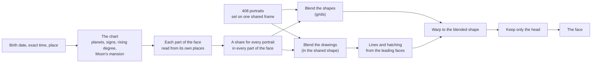

The method is the one composite-face research uses (Galton's composite portraits; the shape-and-texture averaging of modern face studies; Perrett's caricaturing of composites): shape and drawing are blended separately, so the blend has the averaged shape of its angels and still clean, single lines.

### 1. One shared frame

Before any blending, every portrait is set on one frame (450 × 600) by its irises, then registered to the mean face of all of them (an affine match of the inner face, held to within 6% of size and 12 pixels for portraits placed by their eyes, so no face is stretched). Then every face's eyes, nose and mouth sit on the same pixels.


### 2. Each face's own shape

What still differs, once the eyes line up, is each face's own shape: a longer face, a broader jaw, a lower brow. The build measures it point by point (dense optical flow, against a mean that is refined over three rounds), smooths it so it records the shape rather than the strokes, and keeps every warp one-to-one. Three further rounds align every face's features to the mean's to about a pixel. Each portrait is stored warped onto the mean shape, with its own grid (46 × 61 points, 10 pixels apart). Here are four archangels' grids, one of each element, drawn three times stronger than they are:


### 3. Six parts, softly joined

The face is drawn in six parts (hair and outline, face and jaw, brow, eyes, nose, mouth), each with its own mix of portraits. Each pixel takes from the parts around it in smooth proportions, so no seam shows between them. Inside the head every pixel blends; outside, the hair and outline come from the one hair portrait.

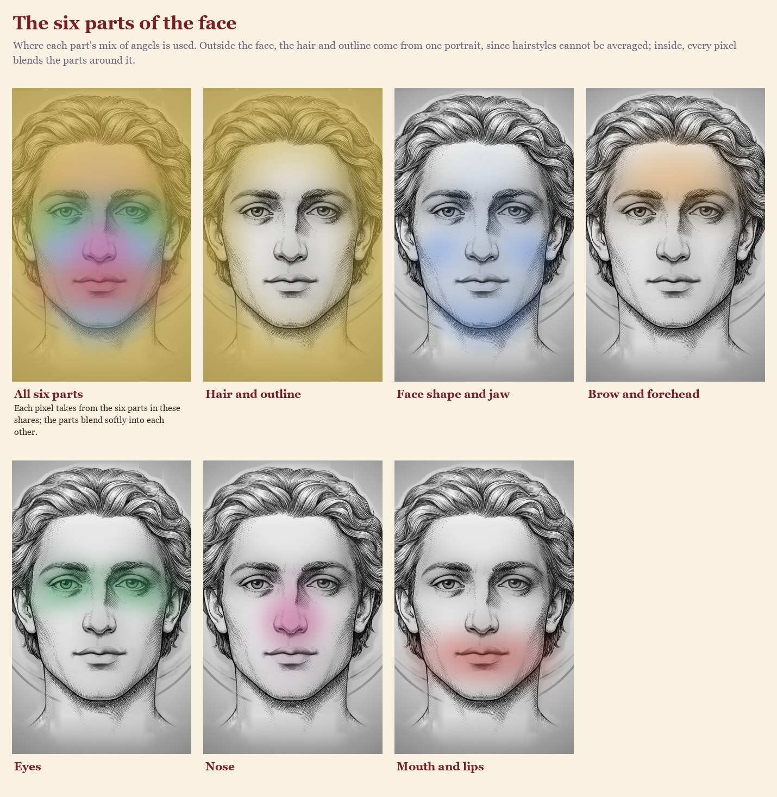

### 4. Clean lines: no ghosting

Averaging many drawings, each line a pixel or two from the others, leaves faint doubled lines and muddy hatching: ghosting. Birth Face blends the **tones** (the broad light and shade) of every portrait in its share, but takes the **fine detail** (every ink line and every stroke of hatching finer than about 22 pixels) only from the portraits that lead at each point:

- **Inside the eyes, nose and mouth:** the few strongest portraits share the lines, by their weights raised to the 6th power, so one face clearly leads.
- **Everywhere else (cheeks, jaw, chin, forehead):** one face draws all the lines for the whole picture, the same face that gives the outline, so the jaw line inside and the outline around it can never lie side by side.
- **The person's own sex** draws the fine lines (so no stubble on a woman's face, no lashes on a man's).
- **Lilly's faces** give their shape but only 12% of their lines and 3% of their drawing: they were drawn as particular people, some old or worn, whose creases must not age the face they help to shape.
- **The hair** comes from the hair portrait only where it actually has hair, and its forehead is brought to the face's own tone, so there is one hairline, never two.

### 5. The chart's lean, strengthened

Blending dozens of portraits pulls every face toward the average. So the app also draws an **average chart** (every element, sign and angel in equal share) and strengthens the chart's difference from it 2.5 times, in the shape and in the broad shading only (strengthening fine tones would double their edges).

### 6. Warped to the chart's shape

Everything so far sits in the shared mean shape. The blended drawing is then warped to the chart's own blended shape. A point that would be drawn from beyond the picture's edge fades out instead of repeating the edge.

### 7. Only the head

Last, only the head itself is kept: the face and ears, the forehead up to the hair, the neck and the hair. Whatever else the portraits carry around the head (their own halo rings, panels and glows) is made see-through, so only the one halo shows, coloured by the chart's elements.

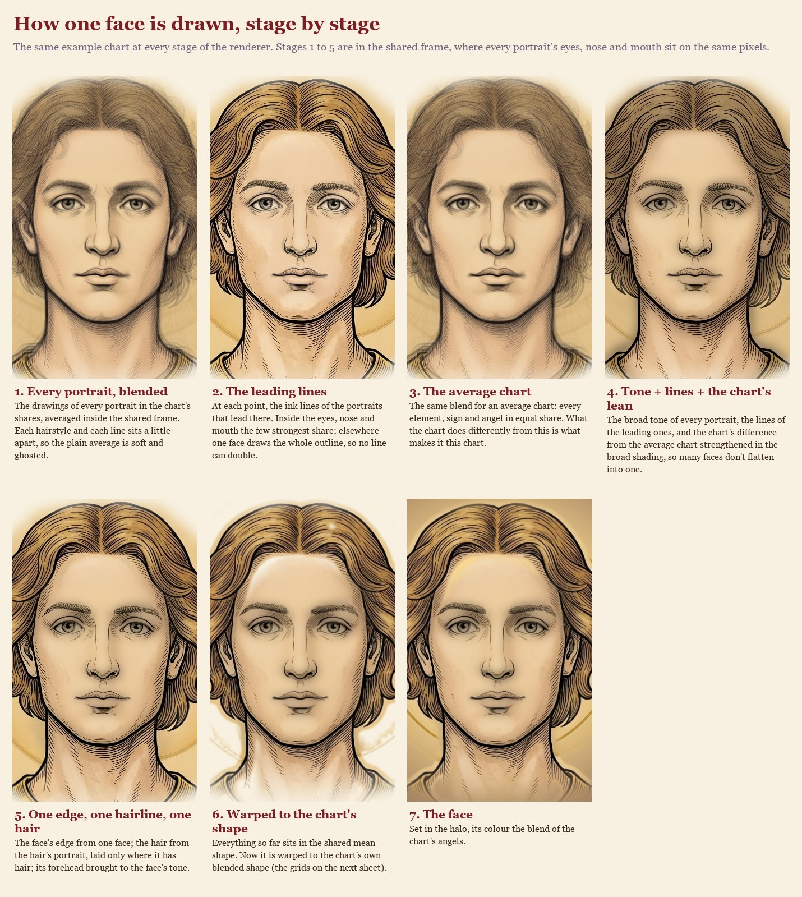


*The same face with parts of the method switched off. The plain average shows the ghosting every other step removes.*

### A finding about shape

Blending a hundred faces evens shape out: in the example chart, the face's shape differs from the average chart's by only about a third of a pixel on average (at most under two pixels). Most of what makes a face its own is in the drawing (the lids, lips, brows and lines), not the outline.

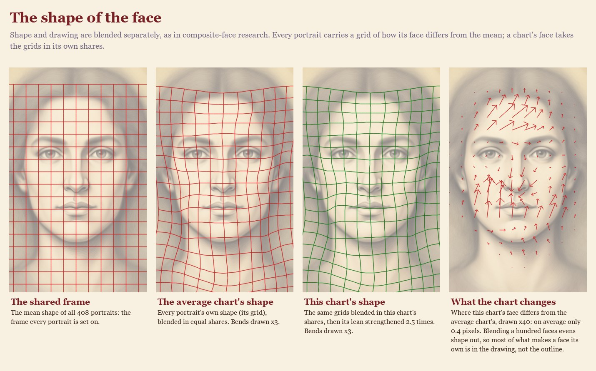

---

## Your choices

The chart and the tradition leave colouring out: skin, hair and eyes take their colour from family, not the sky. So all of it is your own choice, and the face is drawn in the engraving's own colours until you choose.

### The hair

Any portrait's hair can be chosen. Only the hair changes: the head's shape, the face, brows, jaw and neck stay the chart's, and the chart's own hair colour is kept unless you turn that off.


### Skin tone

Nine tones, from fair to deep. The drawing is mapped onto the tone by its own light and shade rather than simply darkened: the bare skin takes the tone, the ink lines its deep shadow, and the hatching between them is spread so it still reads on the darkest tones. The whites of the eyes stay light at every tone.

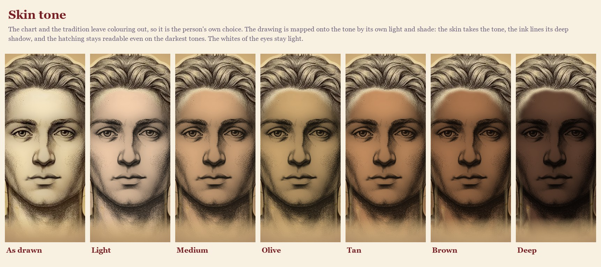

### Hair colour

Eleven colours. Where the hair is, is found from the drawing itself (fine strands close together, outside the face), and only the hair is coloured: the strokes take the colour's shadow, the light between them its highlight, no lighter than the colour allows (black hair shines dark grey, not pale).

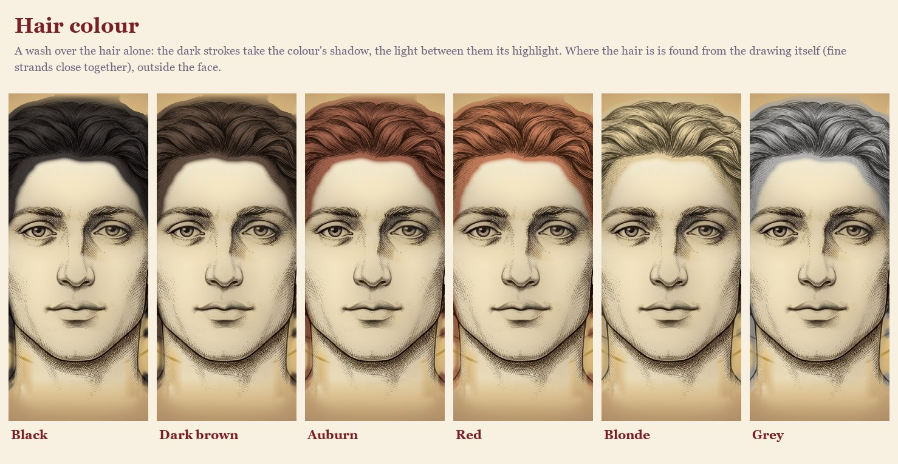

### Eye colour

Eight colours. Each iris is found as a dark disc with the white of the eye on both sides, and only the iris is coloured, keeping its own light and shade.

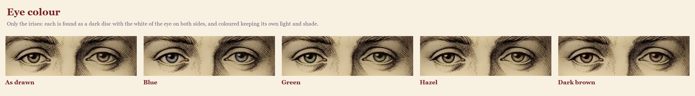

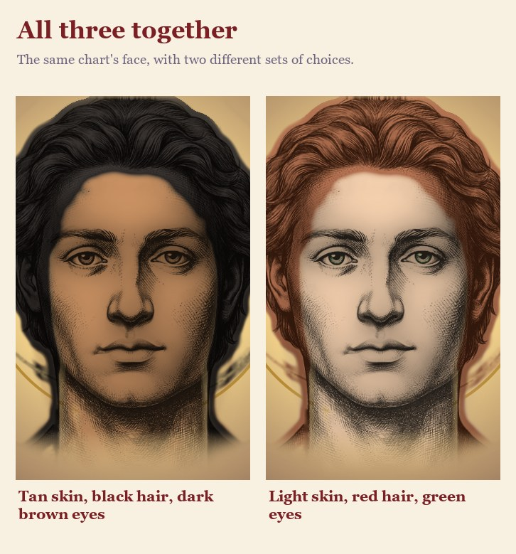

---

## In depth: one face, taken completely apart

Everything below is one made-up example person (born 1990-04-03, 09:00, London), taken apart at every step. All of it comes from the app's own renderer and data; nothing is drawn by hand.

### The sky at the minute of birth

The chart as a wheel: the signs, the 36 decans and their lords, the 72 angels of the Name, the 28 mansions of the Moon and the planets. Beside it, the four ancient readings of the rising degree and the portrait each one calls up.


### Every order of angels

The face drawn from each order of angels alone, with that order's share of the face. The real face draws them together.

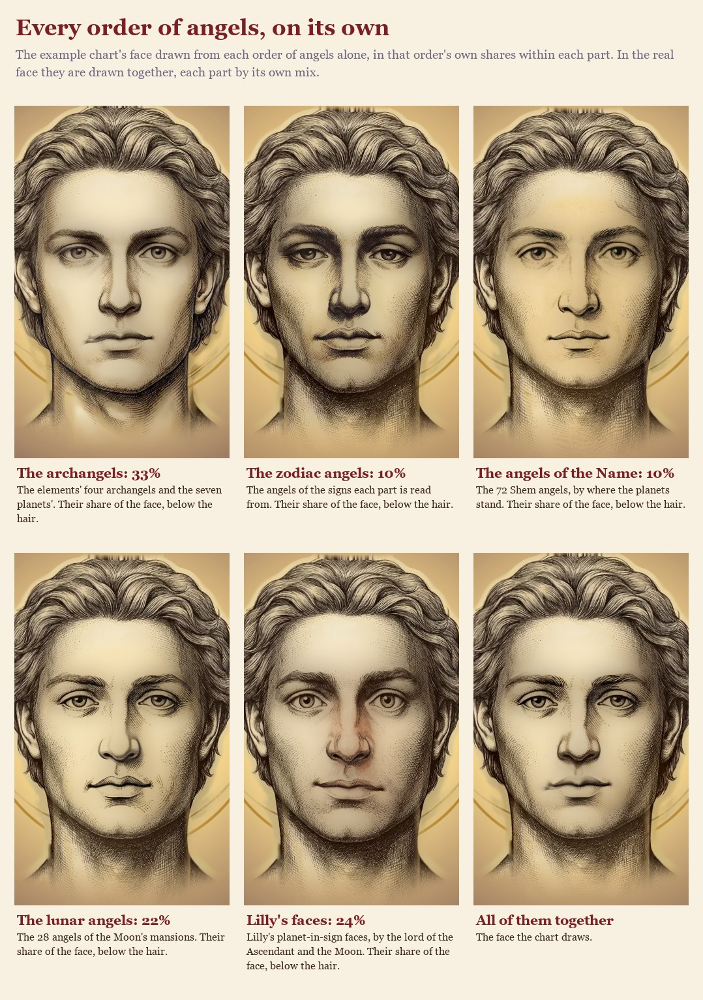

### Every part of the face

Each part of the face is read from its own places in the chart, so each part has its own mix of angels. Here each mix draws a whole face on its own.


### Who sits where

The 52 portraits in this face, mapped point by point: the portrait that gives the hair and outline, then the largest shares inside the face. In this chart the Moon's angel, Barbiel, leads the eyes.

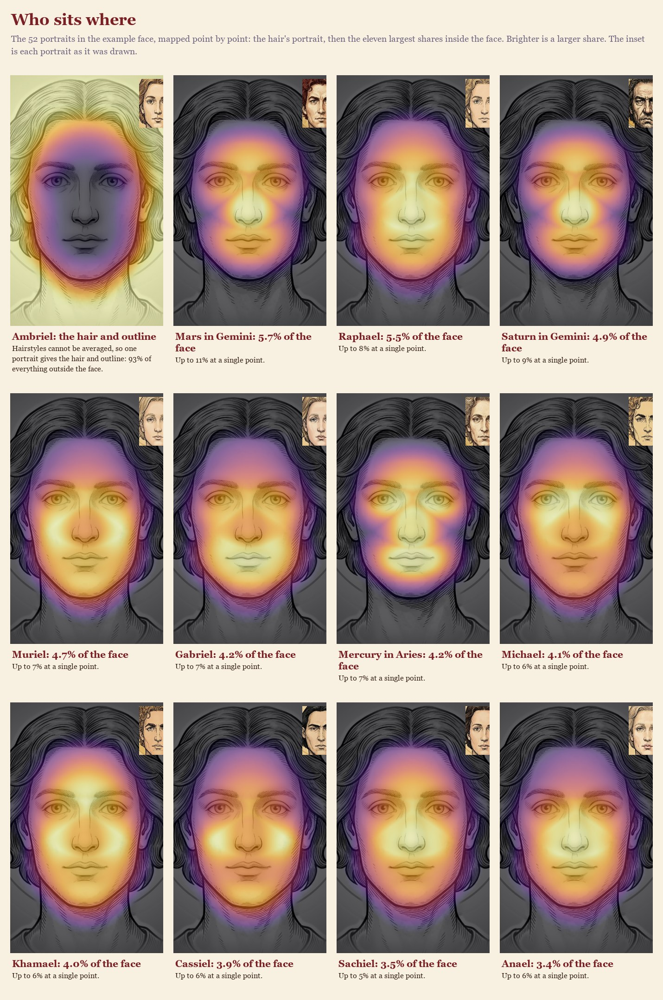

### The portraits it is made of

The 24 portraits with the largest shares across the whole face.

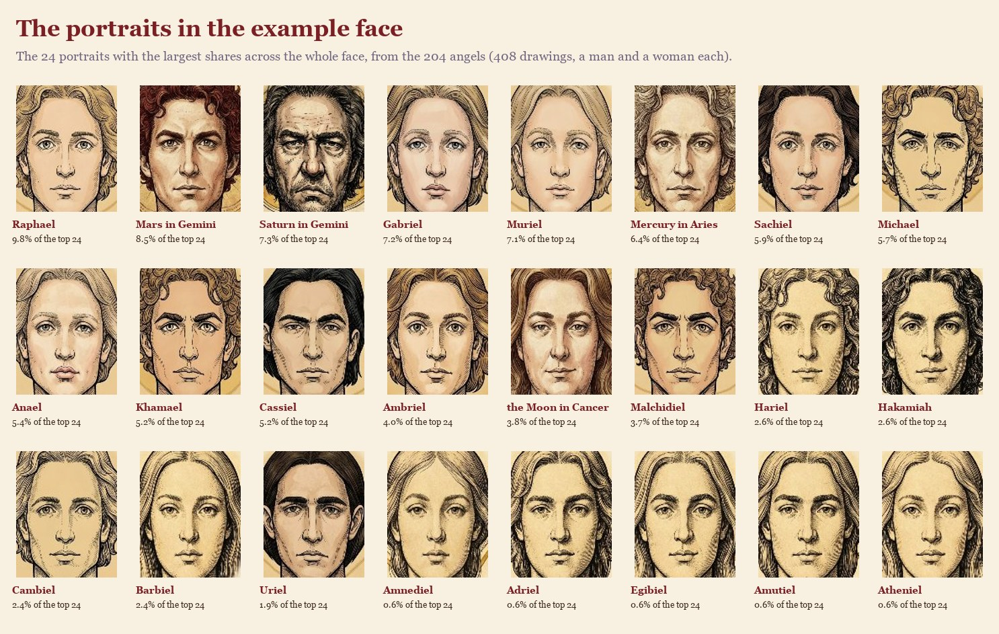

### Every portrait

All 204 angels, each drawn as a man and as a woman: the eight archangels and twelve zodiac angels, the 72 angels of the Name, the 28 lunar angels and Lilly's 84 faces.


---

## The app

### The Face tab

The face, the choices, and what it is made from. Below it, part by part, the portraits it is made of and their shares; point at any spot of the face to see who sits there and in what share.


### The rising degree

Every ancient layer of the exact birth minute (the decan, the drekkana, the angels of the Name, the navamsa, Lilly's degrees) and what each gives the face.


### Describe yourself, and Observations & discovery

**Describe yourself** takes a description of a real face in words (never a photo), finds which planets and elements the tradition ties to each answer, and compares how well the chart explains it with 300 other birth moments at the same place. **Observations & discovery** collects described faces across many people and shows which parts of the chart keep matching.


*A made-up example person with a made-up description, to show how the comparison reads.*

---

## Will it look like you?

It may, in some ways, and it may not, in others. Birth Face is an image of a tradition: the faces the old astrologers said the sky gives, drawn from your own chart. It is not a photograph, and it does not claim to predict how anyone looks.

### Where people tend to see themselves

The tradition reads each feature from its own place in the chart, so a resemblance, when there is one, usually shows feature by feature rather than in the whole face:

- **The eyes and their lids:** drawn mostly by the Moon's angel; a chart strong in water draws heavy, sleepy lids, one strong in earth deep-set eyes.
- **The mouth:** the Moon and Venus give the lips; water draws them full, with a clear bow, earth with a fuller lower lip, fire wider and sharper.
- **The length and breadth of the face:** the rising sign, its lord and the Moon give the frame; earth draws a long face, water a rounder one, fire a strong-boned one.
- **The brows and nose:** Mars and the Sun give the brow, Venus the nose.

People who share the Sun's and Moon's signs (born at the same time of year, with the Moon in the same sign) can get faces that look like relatives: alike in the eyes and mouth, and different in the frame, which comes from the rising sign.

### Why it may not look like you

- **Family and ancestry shape a face far more than anything else.** Two people born at the same minute in the same town have the same chart, and different parents.
- **Colouring is left out on purpose.** You choose the skin tone, hair colour and eye colour yourself.
- **The birth time has to be exact.** A time off by a quarter of an hour can change the frame of the face, near the edge of a sign the rising sign itself, and within a day the Moon's mansion and so the eyes.
- **Age, weight and life change a face.** The chart gives one face for a whole life.
- **The portraits set the style.** Every face is drawn from illustrated angel portraits, so it always looks like an illustration of an ideal, youthful person.
- **The shape varies little.** Blended from so many portraits, faces differ more in their features than in their outline.
- **The tradition itself is unproven.** No study has shown that a birth chart predicts appearance. A likeness may be chance, or the way we look for ourselves in any face.

### Testing it honestly

One striking likeness proves nothing; many people do. The **Describe yourself** tab shows how well a chart explains a described face compared with hundreds of other birth moments, which is what tells a real fit from coincidence, and **Observations & discovery** shows which parts of the chart keep matching across people. The more people with exact birth times are described, the clearer it becomes where the tradition holds and where it does not.

Angels in Birth Face are witnessed, not invoked: the app draws on how the traditions picture them and makes no prayers or rituals.

---

## Running and building it

```
npm install
npm start          # run the app
npm test           # the rising-degree checks
npm run dist       # build the Windows installer (dist/installer)
```

The face data (`app/js/blendfaces-data.js` for the archangels and zodiac angels, and one file per angel in `app/js/shem`, `app/js/mansion` and `app/js/lilly`, loaded only when a face needs it) is built from the portraits by the companion build scripts, which set every portrait on the frame, measure its shape, align its features and encode it. A full build of all 408 portraits runs on every processor core and takes about five and a half minutes.

The portraits are original illustrations made for the app with Google's Nano Banana image models.
