# Birth Face

**A face drawn from the sky at the minute you were born.**

Birth Face is a Windows desktop app. Enter a birth date, an exact time and a place, and it draws a face from the birth chart alone. No photograph is ever used. The face is a blend of over two hundred angel portraits in the style of a gold engraving, each weighed by the oldest ways the tradition reads appearance from the heavens: the rising degree, the elements, the planets, and the angels of the Name and of the Moon.

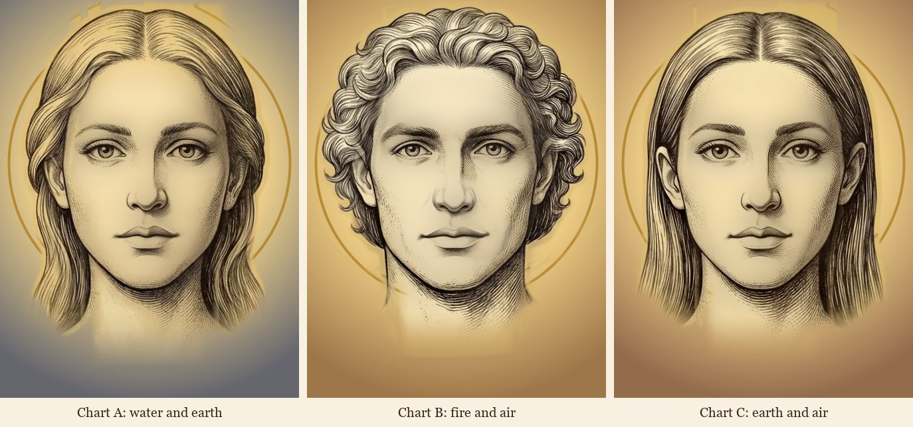

*Three made-up birth charts, three faces. Each is drawn only from its chart: one leaning to water and earth, one to fire and air, one to earth and air.*

---

## How a face is made

Every part of the face (the face shape, brow, eyes, nose, mouth, hair and outline) is read from the places in the chart that the tradition gives it, and drawn from the portraits that stand for those places.

| Layer | What it brings | Source |
|---|---|---|
| **The four elements** | The temperament: fire, air, water and earth in the chart's own proportions, through their archangels Michael, Raphael, Gabriel and Uriel | The temperament tally after William Lilly, *Christian Astrology* (1647) |
| **The planets** | The seven planetary archangels, by each planet's strength in the chart | Ptolemy, *Tetrabiblos* III.11–12 |
| **The zodiac angels** | The angels of the signs each feature is read from (the rising sign for the frame, the Moon for the eyes and mouth, Venus for the nose) | Agrippa; the Golden Dawn |
| **The 72 angels of the Name** | The Shem ha-Mephorash, each holding five degrees of the zodiac, weighed by where the planets stand | Exodus 14:19–21 |
| **The 28 lunar angels** | The angel of the Moon's mansion at birth, who draws most of the eyes and part of the mouth | Barrett, *The Magus* (1801), after Agrippa |
| **Lilly's 84 faces** | The face shape Lilly gives each planet in each sign, for the lord of the Ascendant, any planet rising, and the Moon | Lilly, *Christian Astrology* |

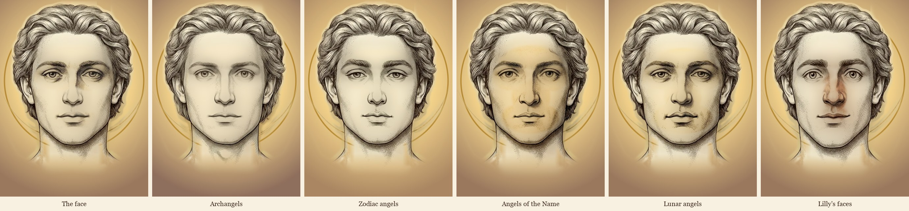

*One chart, order by order: the finished face, then the face each order of angels would give on its own (the archangels, the zodiac angels, the angels of the Name, the lunar angels and Lilly's faces). The finished face draws them together.*

### The eyes

The Moon gives the eyes, so the angel of the Moon's mansion at birth draws most of them (70%); the rest of the chart shapes the other 30%. The Moon's mansion changes about every day, so two people born a day apart can have quite different eyes.

### The rising degree

Birth Face reads the exact degree rising on the eastern horizon in four of the oldest ways, and gives it a third of the face shape, brow and nose:

- **The Egyptian decan:** the ten degrees rising and the planet that rules them, with the two angels of the Name holding its halves.
- **Varahamihira's drekkana** (*Brihat Jataka*, ch. 27): the figure rising, a man or a woman, and its lord.
- **The rising navamsa:** the ninth part of the sign, read for the body.
- **Lilly's degrees** (*Christian Astrology*, p. 116): whether the rising degree is masculine or feminine, and light, dark, smoky or void.

### Masculine and feminine

Every angel is drawn twice, as a man and as a woman. The person's own sex leads; the other lends at most 15% of the features, in proportion to how masculine or feminine the chart is (Ptolemy, *Tetrabiblos* I.6 and I.12). The hair and outline always come from the person's own sex.


*Eight of the portraits: the archangels of the four elements and the seven planets.*

The archangels, zodiac angels and lunar angels are drawn in one gold-engraving style: sepia ink, cream skin, a gold ground. The angels of the Name and Lilly's faces keep an earlier inked style. In a blend they give mostly shape, so the finished face keeps the gold style.

---

## How it works, step by step

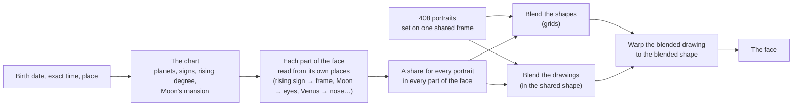

The method is the one composite-face research uses (Galton's composite portraits, and the shape-and-texture averaging of modern face studies): shape and drawing are blended separately, so the blend has the averaged shape of its angels and still clean, single lines.

### 1. One shared frame

Every portrait was made on its own, so each sits a little differently in its picture. Before any blending, the build finds both irises in every portrait, by matching the eyes of the mean face at many sizes, and sets each portrait on one shared frame by them. Then every face's eyes, nose and mouth sit on the same pixels.

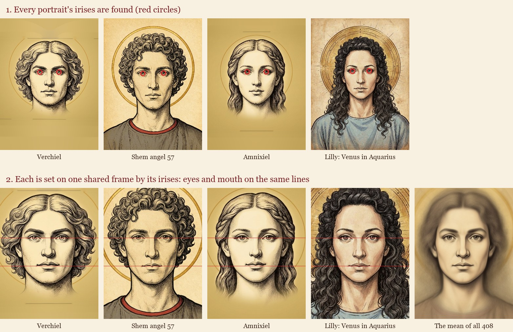

### 2. Each face's own shape

What still differs, once the eyes line up, is the face's own shape: a longer face, a broader jaw, a lower brow. The build measures it point by point (dense optical flow against the mean face) and stores it as a grid for every portrait. Here are four archangels' grids, one of each element, drawn three times stronger than they are:

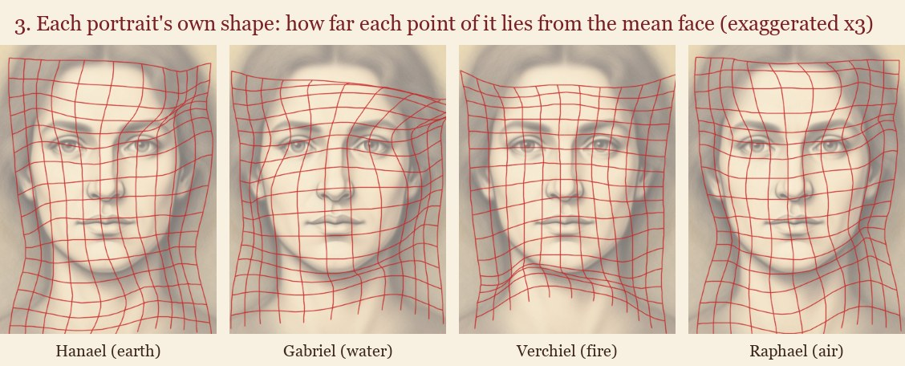

### 3. Blending

For a chart, every portrait gets a share in every part of the face. The grids are blended by those shares into one shape, the drawings are blended inside the shared frame, and the blended drawing is warped to the blended shape. The fine ink lines come from the strongest portraits at each point, so lines never double; the face's distinctive lean (its difference from an average chart's face) is strengthened a little, so blending many faces does not flatten it.

### 4. Who sits inside

The **Face** tab shows the face and, part by part, the portraits it is made of and their shares. Point at any spot to see who sits there.

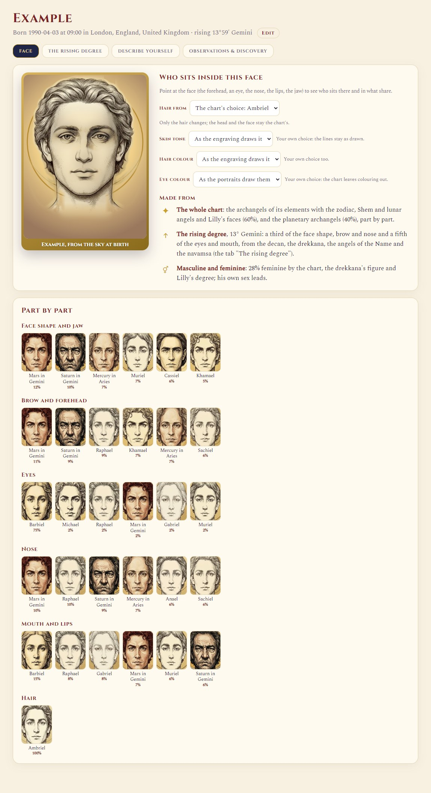

*The Face tab, for a made-up example person.*

### 5. The rising degree

The **Rising degree** tab lists every ancient layer of the exact birth minute and what each gives the face.

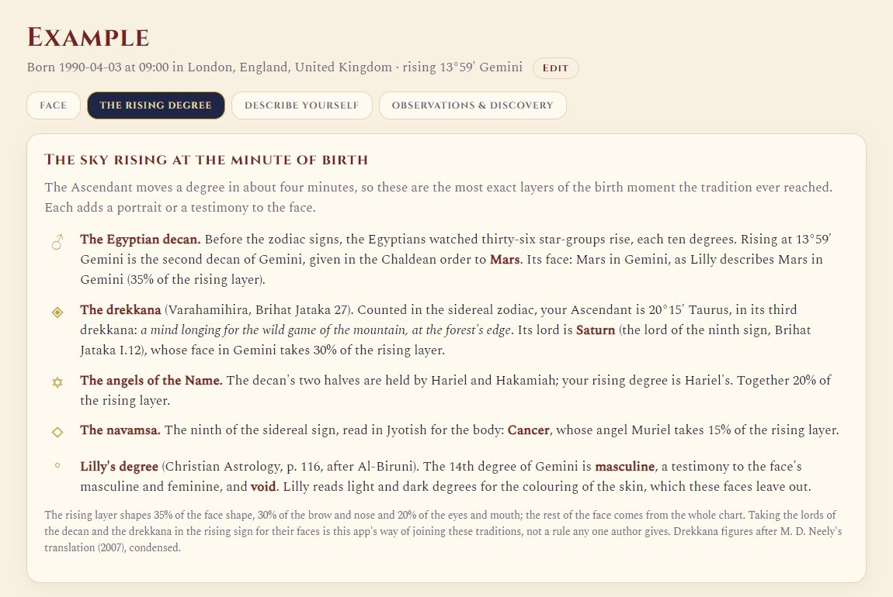

### 6. Testing against a real face

The **Describe yourself** tab takes a description in words (never a photo), finds which planets and elements the tradition ties to each answer, and compares the chart's fit with 300 other birth moments at the same place. **Observations & discovery** then collects described faces across many people.

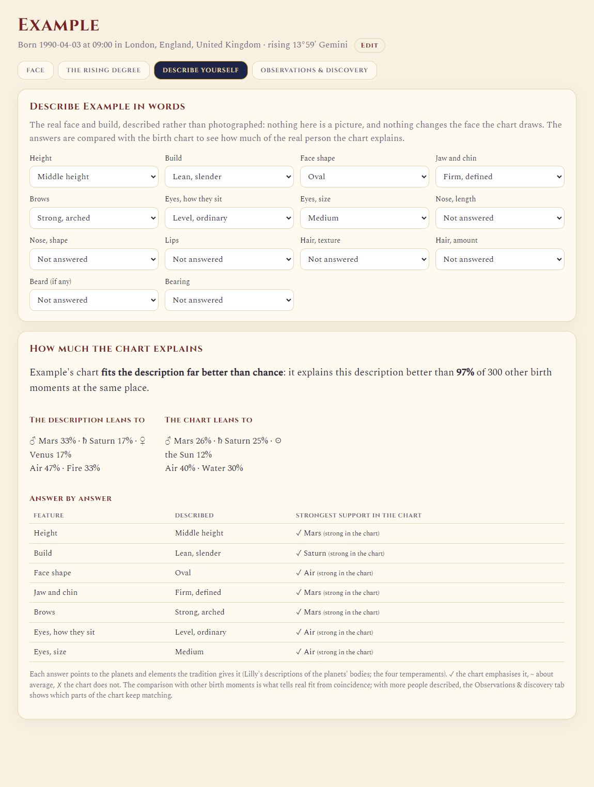

*A made-up example person with a made-up description, to show how the comparison reads.*

### Your choices

- **The hair:** any portrait's hair can be chosen, and only the hair changes. The face, brows, jaw and neck stay the chart's.

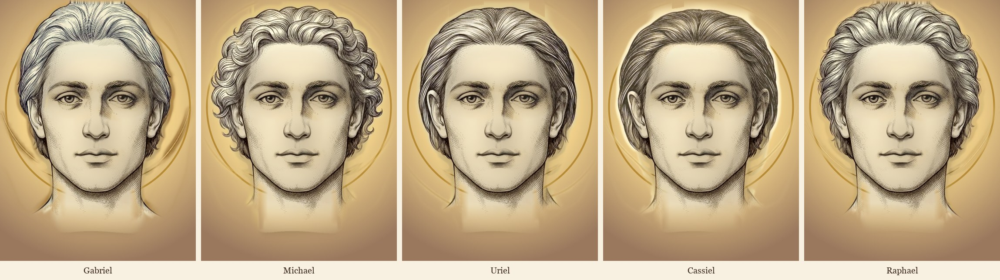

*The same chart's face with the hair of Gabriel, Michael, Uriel, Cassiel and Raphael.*

- **Skin tone, hair colour and eye colour:** the chart and the tradition leave colouring out (skin, hair and eyes take their colour from family, not the sky), so all three are your own choice. The face is drawn in the engraving's own colours until you pick them. Skin tone has nine shades, hair colour eleven and eye colour eight; the ink lines stay as drawn.

---

## In depth: one face, taken completely apart

Everything below is one made-up example person (born 1990-04-03, 09:00, London), taken apart at every step. All of it comes from the app's own renderer and data; nothing is drawn by hand.

### The sky at the minute of birth

The chart as a wheel: the signs, the 36 decans and their lords, the 72 angels of the Name, the 28 mansions of the Moon and the planets. Beside it, the four ancient readings of the rising degree and the portrait each one calls up.

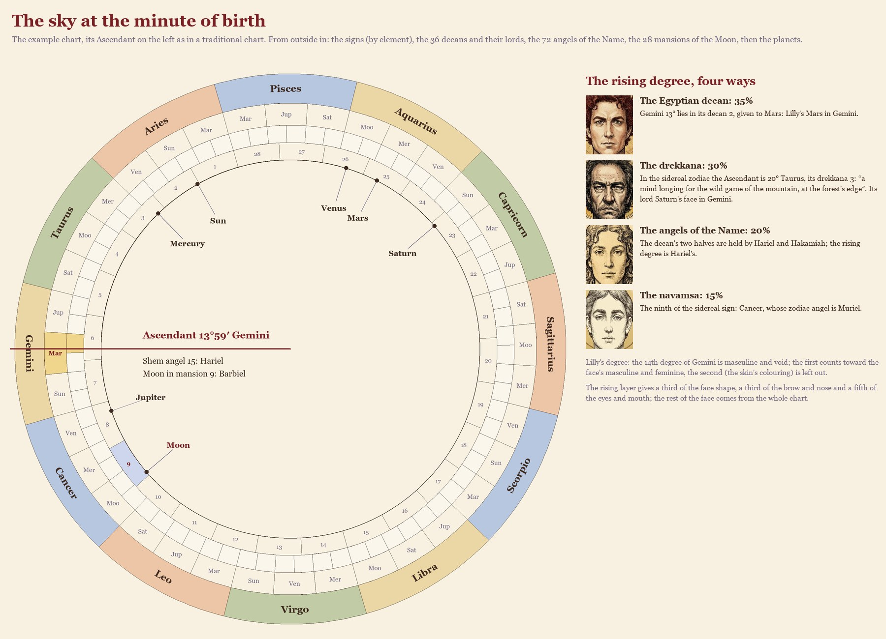

### Every order of angels

The face drawn from each order of angels alone, with that order's share of the face. The real face draws them together.


### Every part of the face

Each part of the face is read from its own places in the chart, so each part has its own mix of angels. Here each mix draws a whole face on its own.

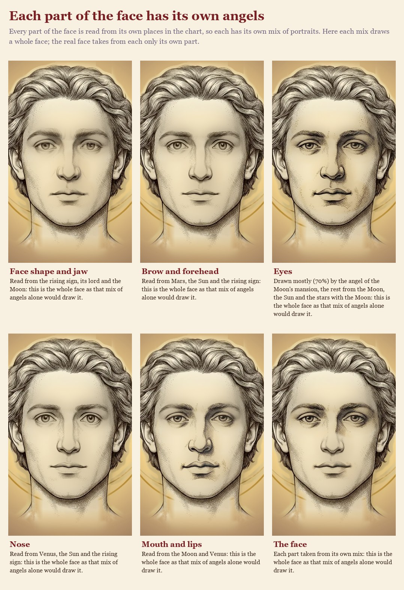

### Where each part is used

The six parts of the face, and how they blend into each other.


### Who sits where

The 52 portraits in this face, mapped point by point: the portrait that gives the hair and outline, then the largest shares inside the face.


### The portraits it is made of

The 24 portraits with the largest shares across the whole face.


### The face, stage by stage

The renderer at every stage, from the plain average of every portrait to the finished face.


### The shape

The face's shape is blended separately from its drawing: every portrait carries a grid of how its face differs from the mean, and the chart's face takes the grids in its own shares.


### What each part of the method does

The same face with parts of the renderer switched off.

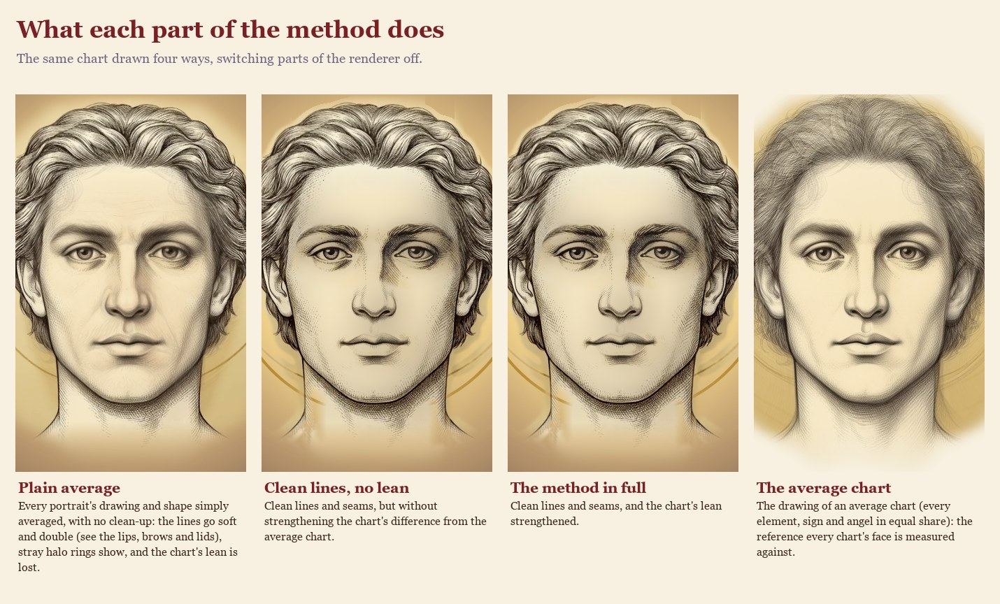

### Every portrait

All 204 angels, each drawn as a man and as a woman: the eight archangels and twelve zodiac angels, the 72 angels of the Name, the 28 lunar angels and Lilly's 84 faces.

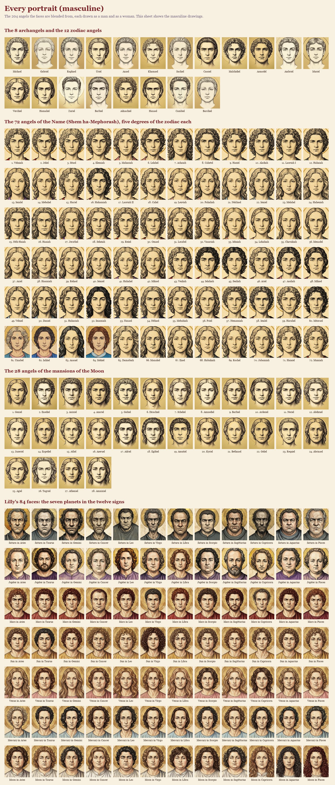

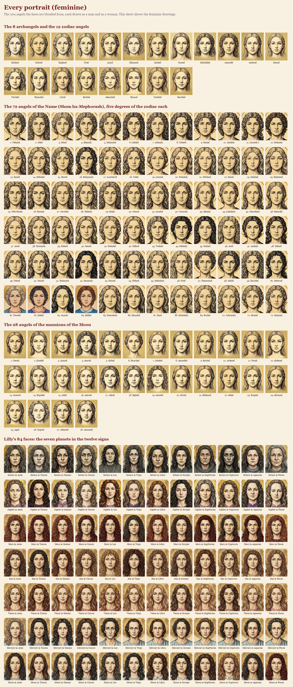

---

## Will it look like you?

It may, in some ways, and it may not, in others. Birth Face is an image of a tradition: the faces the old astrologers said the sky gives, drawn from your own chart. It is not a photograph, and it does not claim to predict how anyone looks.

### Where people tend to see themselves

The tradition reads each feature from its own place in the chart, so a resemblance, when there is one, usually shows feature by feature rather than in the whole face:

- **The eyes and their lids:** the Moon and its sign give the eyes' set and expression; a chart strong in water draws heavy, sleepy lids, one strong in earth deep-set eyes.
- **The mouth:** the Moon and Venus give the lips; water draws them full, with a clear bow, earth with a fuller lower lip, fire wider and sharper.
- **The length and breadth of the face:** the rising sign, its lord and the Moon give the frame; earth draws a long face, water a rounder one, fire a strong-boned one.
- **The brows and nose:** Mars and the Sun give the brow, Venus the nose.

The **Face** tab shows exactly which angels and which places in the chart made each part, so you can see why a feature came out as it did.

### Why it may not look like you

- **Family and ancestry shape a face far more than anything else.** Two people born at the same minute in the same town have the same chart, and different parents.
- **Colouring is left out on purpose.** Skin, hair and eye colour come from family, not the sky, so the face is drawn in the engraving's own colours. You can choose the skin tone, hair colour, eye colour and hair yourself.
- **The birth time has to be exact.** The rising degree moves about one degree every four minutes; a time off by a quarter of an hour can change the frame of the face, and near the edge of a sign the rising sign itself.
- **Age, weight and life change a face.** The chart gives one face for a whole life; yours changes with the years.
- **The portraits set the style.** Every face is drawn from illustrated angel portraits, so it always looks like an illustration of an ideal, youthful person, not a photograph of anyone.
- **The tradition itself is unproven.** No study has shown that a birth chart predicts appearance. A likeness may be chance, or the way we look for ourselves in any face.

### Testing it honestly

The **Describe yourself** tab lets you describe a real face in words (never a photo) and shows how well the chart explains that description, compared with hundreds of other birth moments at the same place. That comparison is what tells a real fit from coincidence. The **Observations & discovery** tab collects described faces across many people and shows which parts of the chart keep matching. The more people with exact birth times are described, the clearer it becomes where the tradition holds and where it does not.

Angels in Birth Face are witnessed, not invoked: the app draws on how the traditions picture them and makes no prayers or rituals.

---

## Running it

```
npm install
npm start          # run the app
npm test           # the rising-degree checks
npm run dist       # build the Windows installer (dist/installer)
```

The portraits are original illustrations made for the app with Google's Nano Banana image models.
